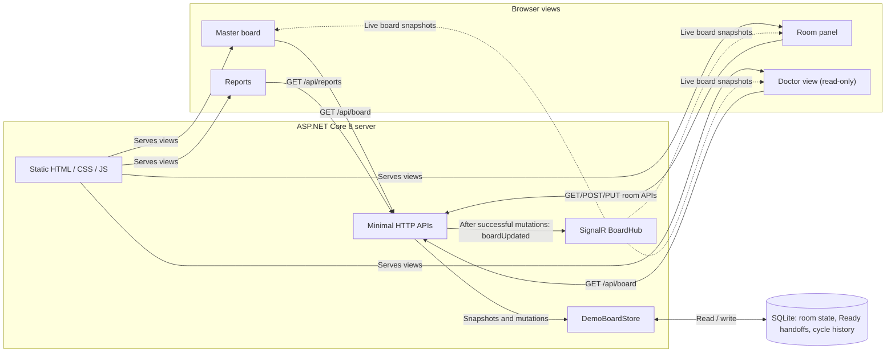
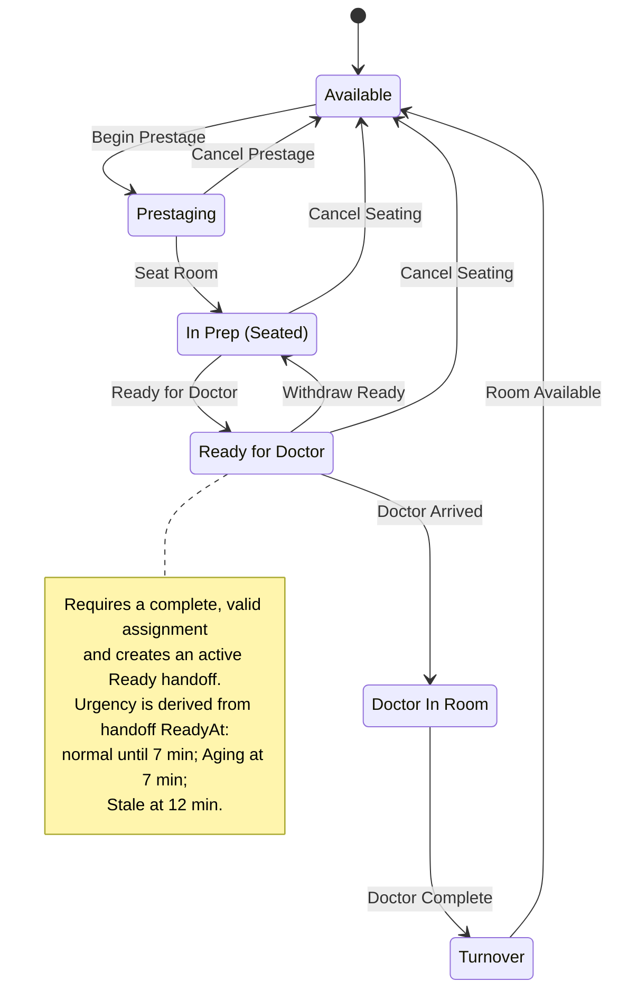
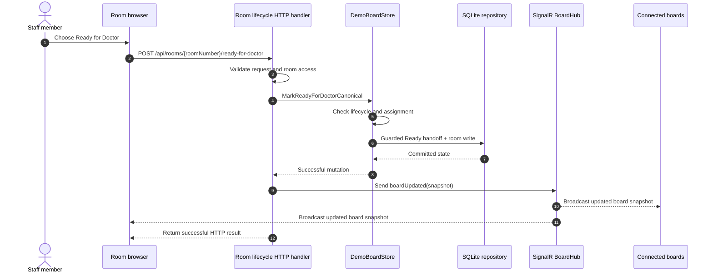

# ChairSide architecture and room workflow

These [Mermaid](https://mermaid.js.org/) diagrams provide a compact map of the **current implementation**. GitHub renders the `mermaid` code blocks directly; no packages, build steps, or running services are required.

ChairSide tracks operational room state only; it does not track patients or PHI. The diagrams summarize normal behavior, not every validation, recovery, concurrency, or administrative path. Source code and tests remain authoritative.

## 1. Application architecture

The browsers share server-owned operational state. `Program.cs` maps `/api/board`, `/api/rooms/{roomNumber}`, room lifecycle routes, reports, and the SignalR hub at `/boardHub`. `DemoBoardStore` applies business rules; `SqliteBoardRepository` persists room state and history. `BoardHub` is used to distribute `boardUpdated` snapshots to connected clients after successful mutations. The diagram omits supporting services such as audit logging, expiration, and access controls for clarity.

## 2. Canonical room lifecycle

**Important distinctions:**

- **Prestaging** starts an episode before an assignment is necessarily complete. **Seat Room** records the actual seated time and advances to the internal `Seated` state, displayed as **In Prep**.
- **Save Details** can correct assignments while Prestaging or Seated without advancing the lifecycle. The **Ready for Doctor** action requires a complete, valid assignment; the room's dispatch-related details then lock. Add-on remains correctable until doctor arrival.
- **Aging** and **Stale** are urgency projections of the current active Ready handoff, **not additional required steps** in the canonical state machine. The defaults are 7 and 12 minutes from the handoff's Ready time (`BoardThresholdOptions` in `appsettings.json`).
- **Withdraw Ready** returns to Seated/In Prep and records the handoff as withdrawn. Reissuing Ready creates a new handoff and restarts urgency. **Cancel Seating** is allowed from Seated or Ready before the doctor arrives; cancelled episodes do not create completed-cycle report entries.
- **Doctor Arrived** accepts the Ready handoff and records seated-to-doctor timing. **Doctor Complete** enters Turnover. **Room Available** ends the cycle, finalizes turnover timing, and resets the room.

## 3. Example event sequence: Ready for Doctor

This illustrates the normal successful path, **not** every possible error or authorization response.

Actual ordering of a client's rendering versus its HTTP response can vary. The server also records an audit entry; this diagram emphasizes the state/persistence/broadcast path.

## Where to verify or update these diagrams

- `src/ChairSide.Board/Program.cs`: HTTP routes, endpoint handlers, SignalR publication.
- `src/ChairSide.Board/Services/DemoBoardStore.cs`: lifecycle rules, validation, urgency projection, snapshots.
- `src/ChairSide.Board/Services/SqliteBoardRepository.cs`: persisted room states, guarded handoff operations, completed cycles.
- `src/ChairSide.Board/Hubs/BoardHub.cs`: SignalR hub type.
- `src/ChairSide.Board/appsettings.json`: default room count and timing thresholds.

Edit the Mermaid source blocks above whenever their related flow changes. GitHub renders them in Markdown; the [Mermaid Live Editor](https://mermaid.live/) is useful for experimenting with layouts. No runtime Mermaid dependency belongs in ChairSide.
